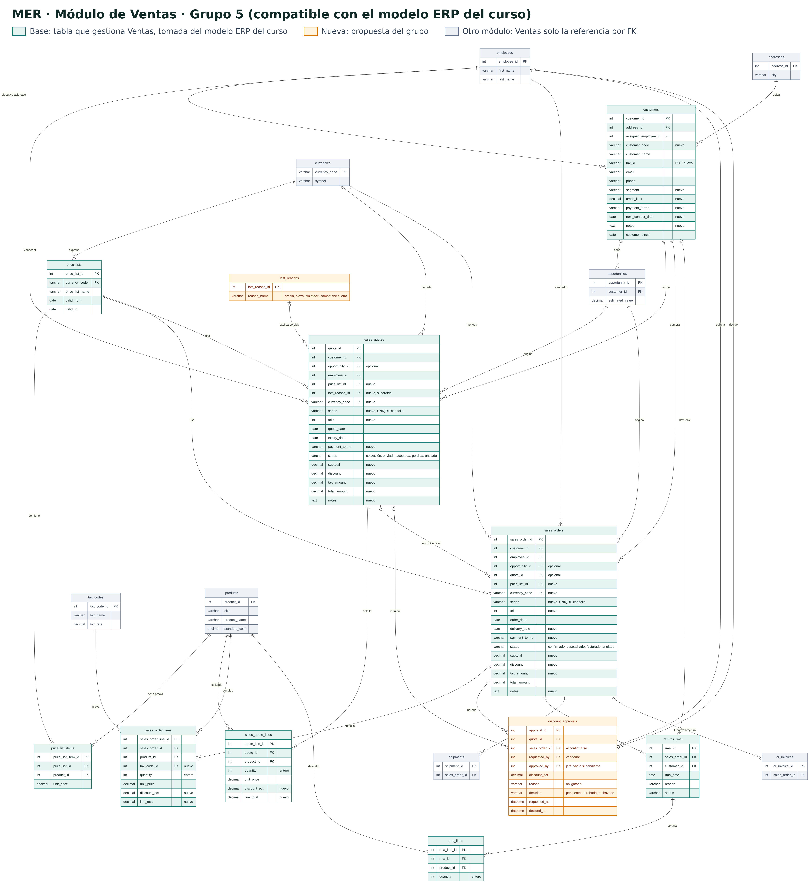

# Grupo 5 · Módulo de Ventas

**Modelación de Sistemas (580211-1) · Universidad de Concepción**

## Módulo asignado

Ventas

## Integrantes

| Nombre | GitHub |
|---|---|
| Joaquín Ignacio Espinoza Mella | [@mellajoaco-hub](https://github.com/mellajoaco-hub) |
| Ezequiel Ernesto Romero Cifuentes | [@EzequielERC](https://github.com/EzequielERC) |
| Pedro Pablo Chávez González | [@pedropablochavez](https://github.com/pedropablochavez) |
| Antonio Alberto Araneda Lepe | [@antonio-araneda](https://github.com/antonio-araneda) |
| Francisca Belén Arias Díaz | [@frarias11](https://github.com/frarias11) |
| Sebastián Eduardo Amigo Pereira | [@xTatan](https://github.com/xTatan) |

## Propósito del proyecto

Nuestro proyecto busca construir el módulo de Ventas de un sistema ERP para una pyme distribuidora, como una ferretería mayorista que vende a empresas constructoras. Hoy muchas de estas empresas cotizan con planillas y correos, lo que provoca errores en los precios, descuentos sin control y ventas a clientes que ya no tienen crédito disponible. Queremos que el módulo ordene todo el proceso, desde la cotización hasta el pedido confirmado: que calcule automáticamente el IVA y los totales, que valide los datos del cliente y que respete reglas claras, como pedir la aprobación de un jefe cuando un descuento es demasiado alto.

Además de ordenar el trabajo diario, queremos que el módulo ayude a tomar mejores decisiones. Por eso registra también las ventas que se pierden y su motivo, y no solo las que se ganan, para que la empresa aprenda por qué pierde clientes. Junto con eso, ofrece un panel con indicadores simples, como las ventas del mes, los mejores clientes y una proyección de ventas. Todo esto lo desarrollamos con Spec Driven Development: primero definimos el modelo de datos y las especificaciones, y después construimos el código con apoyo de inteligencia artificial, cuidando la privacidad de los datos y evitando sesgos en las reglas del sistema.

## Avance para la revisión (jueves 22 de octubre)

| Lo que se pide | Dónde está |
|---|---|
| Modelo entidad-relación y compatibilidad con la estructura base | [`docs/mer.png`](docs/mer.png) (diagrama) y [`specs/002-modulo-ventas/data-model.md`](specs/002-modulo-ventas/data-model.md) (tablas, columnas, justificación y compatibilidad) |
| Plan de trabajo del módulo | [`plan.md`](plan.md) |



## Cómo ejecutar

Requisitos: [Node.js](https://nodejs.org/) 20 o superior y un navegador moderno.

```bash
git clone https://github.com/MDS-BI/grupo-05.git
cd grupo-05
npm install
npm run dev        # abre http://localhost:5173
```

Pruebas automáticas (142: 111 del template + 31 de Ventas):

```bash
npx vitest run     # una sola ejecución
npm test           # modo observación
npm run build      # versión de producción en dist/
```

## Demostración en 3 minutos

1. Arriba a la derecha, cambia el **Perfil** a *Jefe/a de ventas*: aparecen el margen bruto, los botones para aprobar descuentos y los de datos.
2. En el **Panel**, presiona **Cargar datos de demostración** (10 clientes y ~40 pedidos ficticios; solo el jefe/a ve este botón).
3. En **Pedidos de Venta**, elige un cliente, agrega productos y pon 15 % de descuento en uno. Escribe el motivo del descuento, guarda e intenta confirmar: queda bloqueado hasta que se apruebe.
4. Aprueba la solicitud en el Panel y confirma el pedido.
5. En **Clientes**, prueba un RUT inválido (`12.345.678-9`) y revisa el crédito usado y disponible.

Recorrido detallado: [specs/002-modulo-ventas/quickstart.md](specs/002-modulo-ventas/quickstart.md).

## Documentación del proyecto

| Documento | Contenido |
|---|---|
| [plan.md](plan.md) | **Plan de trabajo del módulo**: funcionalidades, compatibilidad con el ERP, análisis, riesgos, escalabilidad, roles y cronograma |
| [docs/propuesta-mvp.md](docs/propuesta-mvp.md) | Problema, cliente, usuarios y alcance del MVP |
| [docs/mer.png](docs/mer.png) | Modelo entidad-relación ([fuente Mermaid](docs/mer.mmd)) |
| [specs/002-modulo-ventas/spec.md](specs/002-modulo-ventas/spec.md) | Especificación: historias de usuario, requisitos y criterios de éxito |
| [specs/002-modulo-ventas/plan.md](specs/002-modulo-ventas/plan.md) | Plan técnico y estructura del código |
| [specs/002-modulo-ventas/research.md](specs/002-modulo-ventas/research.md) | Decisiones técnicas y alternativas descartadas |
| [specs/002-modulo-ventas/data-model.md](specs/002-modulo-ventas/data-model.md) | Tablas, columnas, justificación y mapeo a `localStorage` |
| [specs/002-modulo-ventas/tasks.md](specs/002-modulo-ventas/tasks.md) | Tareas ejecutadas por historia de usuario |
| [docs/decisiones.md](docs/decisiones.md) | Decisiones del grupo (se registran también como Issues) |
| [docs/analisis-escalabilidad.md](docs/analisis-escalabilidad.md) | Qué pasa con más usuarios, más datos y más módulos |
| [docs/riesgos-y-sesgos.md](docs/riesgos-y-sesgos.md) | Riesgos de datos, privacidad y sesgos |
| [docs/plan-de-trabajo.md](docs/plan-de-trabajo.md) | Acuerdos de trabajo del grupo y preguntas al equipo docente |
| [docs/capturas/](docs/capturas/) | Capturas del panel, un pedido, la búsqueda y la vista móvil |
| [docs/guion-presentacion.md](docs/guion-presentacion.md) | Guion de 5 minutos (cualquier integrante puede presentar) |
| [.specify/memory/constitution.md](.specify/memory/constitution.md) | Constitución v1.1.0 (agrega el principio de privacidad y sesgos) |

## Estructura

```text
src/profiles/ventas.js     # todo lo específico de Ventas: términos, campos, estados, catálogo
src/sales/sales-logic.js   # reglas puras: RUT, totales, crédito, indicadores, pronóstico
src/sales/demo-data.js     # datos ficticios deterministas
src/storage.js             # guardar, validar, aprobaciones, exportar/importar
src/components/            # pantallas: panel, clientes, pedidos, búsqueda
tests/                     # pruebas unitarias y de integración
```

Para volver al módulo base genérico, en `src/module-config.js` cambia `userConfig = ventasProfile` por `userConfig = null`.

> **Nota sobre el template:** el repositorio entregado no traía `src/` ni `index.html`. El grupo reconstruyó el núcleo a partir de `specs/001-erp-base-module/` y de sus 111 pruebas, que pasan todas. Luego agregó Ventas como un perfil de configuración más una extensión opcional (`sales`).

## Escalabilidad en una línea

Con `localStorage` el MVP sirve para un vendedor en un navegador (~5 MB). Para varios usuarios se necesita un backend con base de datos: el MER ya está separado en las tablas finales. Detalle en [docs/analisis-escalabilidad.md](docs/analisis-escalabilidad.md).

---

## Documentación del template base


Minimal single-page app serving as an Enterprise Resource Planning (ERP) software base module. It provides the common foundation for building custom ERP modules: master data management (Entities) and linked transactional documents (Documents) with create/edit/delete/search, validation, and browser localStorage persistence — using Vite and vanilla HTML, CSS, and JavaScript.

The user interface is fully in **Spanish** (default terms: Entidad / Documento; module name: Módulo Base ERP), including labels, validation messages, empty states, and dialogs.

Entities carry standard ERP master-data fields (name, code, tax ID, email, phone, address, category, target date, credit limit, payment terms). Documents use series + folio numbering and carry a monetary breakdown (subtotal, discount, tax, total), currency, payment terms, notes, quantity, dates, and status.

The app presents itself as a coherent ERP workspace:

- **Workspace shell** — every screen lives inside a branded chrome: a top bar with a logo (an SVG monogram derived from the module name) and module name, plus a persistent sidebar of module buttons (Panel, Entidades, Documentos, Búsqueda). The active module is highlighted (`aria-current="page"`), and the sidebar collapses to an icon rail on narrow viewports.
- **Home dashboard** — the entry screen offers quick-action buttons for key ERP tasks (new entity, new document, open management areas, find records) and live statistic cards showing record counts.
- **Design tokens** — styling is driven by CSS custom properties in `src/styles.css`, so branding changes apply globally.

### Setup

Install dependencies and run the dev server:

```bash
npm install
npm run dev
```

Open http://localhost:5173 (or the URL Vite prints).

### Tests

Run the full test suite (unit + integration) with:

```bash
npm test
```

Or a one-off run without watch mode:

```bash
npx vitest run
```

### Building Custom Modules

Custom ERP modules built on this base define:

- What an **Entity** represents (e.g., customer, product, asset) plus domain-specific fields.
- What a **Document** represents (e.g., order, invoice, contract).
- Module-specific labels and validation rules.

The base module handles identity generation, timestamps, referential integrity between entities and documents, cascade deletion, navigation, and search. See `specs/001-erp-base-module/` for the full specification.

### Tailoring via Configuration

All tailoring lives in one place: the `userConfig` object at the top of `src/module-config.js`. Developers edit this single export; no core code changes are required. Available knobs:

- `moduleName` — display name shown in the top bar, dashboard, and document title; also derives the logo monogram.
- `labels` — rename Entity/Document terms across every screen, including sidebar buttons, quick actions, forms, and messages. Spanish articles and agreements (el/la, seleccionado/a) are derived from the first word of each configured term.
- `customFields` — declare extra fields per record type with `target` (`entity` or `document`), `key`, `label`, `type` (`text`, `number`, `date`, or `select`), optional `required`, and `options` for selects. Keys must not collide with base field names (see `specs/001-erp-base-module/data-model.md`). Values persist alongside records and appear in search results.
- `statusLifecycle` — restrict document statuses to a configured list of `statuses` with permitted `transitions` between them. Without it, status stays a free-form field.
- `theme.accentColor` — a hex color (e.g., `"#0f62fe"`) applied across the shell as highlights and primary controls. Invalid values fall back to the default.

If the configuration is invalid (unknown types, bad keys, transitions referencing unknown statuses, non-hex accent colors), the app shows the problems in a banner and falls back to defaults instead of breaking.

### Notes

- Data is persisted to `localStorage` under the keys `erp_base_module:entities` and `erp_base_module:documents`.
- Deleting an entity also deletes its documents (cascade).
- This project intentionally uses vanilla HTML, CSS, and JavaScript for simplicity.
